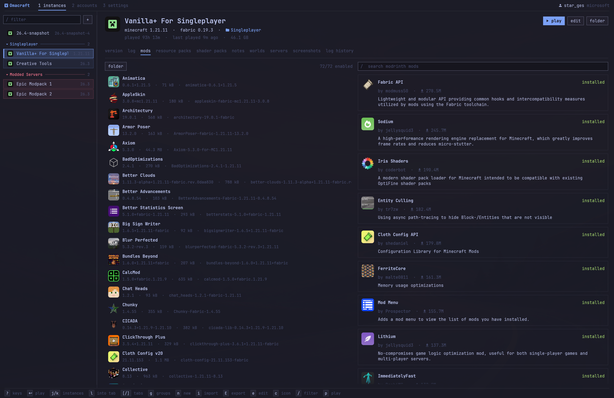

# Omacraft



A Minecraft launcher in Rust, modeled on [Prism Launcher](https://github.com/PrismLauncher/PrismLauncher)
and drawn in [Omarchy](https://omarchy.org)'s design language.

It follows your Omarchy theme and changes with it, and on other systems it uses Tokyo Night.
You can drive the whole thing with vim-style keys, or just use the mouse.

## Install

You need Rust 1.95 or newer ([rustup](https://rustup.rs)). Then:

```sh
git clone https://github.com/star-ges/omacraft
cd omacraft
cargo build --release
install -Dm755 target/release/omacraft ~/.local/bin/omacraft
install -Dm644 packaging/omacraft.desktop ~/.local/share/applications/omacraft.desktop
install -Dm644 packaging/omacraft.svg ~/.local/share/icons/hicolor/scalable/apps/omacraft.svg
```

It runs on Linux (x86_64) under Wayland or X11. File pickers use the XDG desktop portal, and fonts
are found with fontconfig. Java isn't needed: Omacraft downloads the runtime each Minecraft version
expects.

## Uninstall

Remove the three installed files:

```sh
rm ~/.local/bin/omacraft ~/.local/share/applications/omacraft.desktop ~/.local/share/icons/hicolor/scalable/apps/omacraft.svg
```

That keeps your instances and settings. To delete those as well, including every world and your
signed-in accounts:

```sh
rm -rf ~/.local/share/omacraft ~/.config/omacraft
```

## Features

- **Instances**: each one is a self-contained `.minecraft` with its own version, loader, memory,
  JVM args, Java, window size, icon, group and notes. Libraries, assets and runtimes are shared
  between instances.
- **Loaders**: vanilla (every release and snapshot), Fabric, Quilt, Forge and NeoForge. Forge 1.13+
  and NeoForge patch the game on the first launch of each build, so that launch takes a minute longer.
- **Modrinth**: search and install mods, resource packs and shader packs, with dependencies resolved.
  Installed items show their name, icon and version.
- **Import**: Prism, PolyMC and MultiMC instances (found automatically, or from a `.zip` or folder)
  and Modrinth packs (a `.mrpack` or a modrinth.com modpack link). Drop a file on the window to import
  it. On btrfs, even huge instances import instantly.
- **Disk dedup**: each mod and pack is downloaded once. On btrfs or xfs, every instance gets its own
  copy, but the bytes are stored only once. **settings → reclaim disk space** merges identical files that
  came in another way (imports, jars added by hand) and clears cached downloads no instance uses.
- **Export**: a Modrinth pack (`.mrpack`) or an instance zip that Prism, PolyMC and MultiMC open.
  You choose which folders go in.
- **Per-instance tabs**: version and loader, live game log, mods, resource packs, shader packs, notes,
  worlds (open one directly on 1.20+, rename, duplicate, delete), servers (edit the list, join directly),
  screenshots (just this instance's, or every instance's at once) and past logs and crash reports.
- **Groups**: collapsible groups in the instance list, each with an optional colour from the theme.
  Drag instances between them, or press `g` to manage them.
- **Accounts and skins**: Microsoft and offline accounts. A 3D preview of each skin and cape; upload a
  skin, switch between classic and slim arms, or pick a cape you own.
- **Keyboard first**: `h`/`l` move between panes and `j`/`k` within them, `enter` does the obvious
  thing (play, join, install, open) and `p` plays from anywhere. The bottom bar shows the keys for the
  focused pane, `?` lists them all, and every key can be rebound in **settings → keys** or in `config.toml`:
  ```toml
  [keys]
  down = ["j", "down"]
  play = ["p", "ctrl+enter"]
  ```
- **CLI**, for Hyprland binds or the Omarchy menu:
  ```
  omacraft list                 # grouped like the sidebar; tab-separated when piped
  omacraft launch <instance>
  omacraft create <name> <version> [fabric|quilt|forge|neoforge]
  omacraft mod add <instance> <modrinth-slug>
  omacraft import <zip|mrpack|folder|url>
  omacraft export <instance> <file.zip|file.mrpack>
  omacraft reclaim              # merge duplicate mods/packs across instances
  omacraft theme
  ```

Not supported: CurseForge packs and downloads, LiteLoader, and Forge before 1.6.

## How Omacraft handles game files

Every instance stays a normal `.minecraft` folder that Minecraft, and you, can use as usual. On top of that:

- **Each download is stored once.** Mods and packs from Modrinth go into a content store and are copied into
  each instance. On btrfs or xfs those copies are reflinks, so they take no extra space, yet every instance
  can still change its own files freely. **settings → reclaim disk space** (or `omacraft reclaim`) merges
  identical files that arrived some other way. It only merges files whose bytes match exactly, through
  the kernel's dedupe call, which checks them first.
- **Share sets** share resource packs, shader packs and schematics between instances. Pick one under
  **share set** when editing an instance. Its folders become links into `shared/`; files with the same name
  but different contents keep both copies, the newcomer renamed. Leaving a set gives the instance its own copy
  of everything again, which is free on btrfs. Packs are often tied to a Minecraft version, which is why sets
  are named groups rather than one global pool.
- **World sets** share worlds between instances that play the same Minecraft version and loader, for
  example two Fabric instances with different client mods. Pick one under **world set**. When one member
  changes version, Omacraft asks whether to change the whole set or leave it with a copy of the worlds.
  Each world records which instance last played it and with which mods (`omacraft.toml` in the world).
  If a world was last played with a mod this instance lacks, or a newer version of one, Omacraft warns
  in the log and backs the world up before the game starts. It never blocks the launch.
- **Game settings are copied, not shared.** The new-instance dialog can copy `options.txt` (keybinds, FOV,
  sound) from another instance once. A live shared file would lose keys, since older versions drop
  settings they don't know.
- **Backups.** When a game exits, each world it played is backed up (the last 5 per world by default, set
  under **settings → backups**; 0 turns it off). The worlds tab has a backups pane to back up now,
  restore or delete, and worlds you deleted stay listed by their backups. Restoring backs up what's there
  first. Backups are reflink copies too, so on btrfs they cost only what changed.
- **Mod updates and rollback.** In the mods tab, `u` checks Modrinth for updates and installs them all, and
  `shift+u` updates one. Before anything changes, Omacraft backs up the instance's `mods` and `config`
  and any world without a recent backup, and stops if that fails. `z` rolls the mods back to such a
  backup and offers to restore each world that was played with the newer mods.

Exports always contain real files, never links, so a shared instance exports like any other.

## Omarchy integration

| What | Source |
|---|---|
| Palette | `~/.local/state/omarchy/current/theme/colors.toml` |
| Control and menu states | `[controls]` and `[menu]` in the generated `shell.toml`, as the Omarchy shell's menus use |
| Modal and toast border | `[hyprland] active-border` (your window border colour) |
| Font and size | fontconfig `monospace` (what `omarchy font set` writes) and `[font] base-size`; icons from a Nerd Font, with one bundled as a fallback |

Outside Omarchy it uses Omarchy's stock Tokyo Night theme. The window has no client-side decorations,
since Hyprland draws the frame, and its Wayland app-id is `omacraft`, for window rules.

## Microsoft sign-in

Omacraft ships its own Azure app ID, approved by Mojang for the Minecraft API, so sign-in works
without any setup. The **settings → client id** field (or `OMACRAFT_MSA_CLIENT_ID`) is only for
using a different Azure app; leave it empty otherwise. If you fork Omacraft, register your own
Azure app and get it approved by Mojang rather than shipping this one. Prism's ID is licensed to
Prism alone, so don't borrow it.

## Where things live

```
~/.config/omacraft/config.toml
~/.local/share/omacraft/
  instances/<id>/instance.toml
  instances/<id>/minecraft/        game dir (mods/, saves/, …)
  groups.toml                      group order and colours
  icons/                           your own instance icons
  shared/sets/<set>/               share sets' packs and schematics
  shared/worlds/<set>/saves/       world sets' worlds
  backups/                         world and mod backups
  cache/content/                   downloaded mods and packs, by SHA-1
  libraries/  assets/  versions/  runtimes/  meta/
  accounts.json                    0600
```

## Contributing

See [CONTRIBUTING.md](CONTRIBUTING.md) for building, testing and how the code maps onto Prism's.

## Credits

The instance icons in `assets/icons/` are unmodified copies of [Prism Launcher](https://github.com/PrismLauncher/PrismLauncher)'s
(`launcher/resources/multimc/scalable/instances/`), apart from `omacraft.svg`. All but three are by Prism Launcher
and its contributors (AutiOne, Boba, ely, Fulmine, gon sawa, Pankakes, tobimori, Zeke, Santiago Cézar),
licensed [CC BY-SA 4.0](https://creativecommons.org/licenses/by-sa/4.0/). `fabricmc.svg`, `quiltmc.svg` and
`neoforged.svg` are the Fabric, Quilt and NeoForged logos, used only to identify those loaders. Their
artwork is openly licensed: Fabric's is Copyright 2016 FabricMC under Apache 2.0
([fabric-loader](https://github.com/FabricMC/fabric-loader); see `assets/icons/fabricmc-LICENSE`), Quilt's is
[CC0 1.0](https://creativecommons.org/publicdomain/zero/1.0/) ([QuiltMC/art](https://github.com/QuiltMC/art)),
and NeoForged's is by the NeoForged Project under [CC BY 4.0](https://creativecommons.org/licenses/by/4.0/)
([neoforged/websites](https://github.com/neoforged/websites); redrawn as an SVG by Sefa Eyeoglu). None of those
licenses cover trademarks: the names and logos belong to their projects, and Omacraft isn't affiliated with them.

`assets/fonts/SymbolsNerdFontMono-Regular.ttf` is [Nerd Fonts](https://github.com/ryanoasis/nerd-fonts)'
Symbols Only font v3.5.1 (MIT, see `SymbolsNerdFont-LICENSE`). It's bundled as a fallback so icons
render without a Nerd Font installed; a system Nerd Font takes precedence.

## License

[MIT](LICENSE). The bundled icons, logos and font keep their own terms, listed under Credits.
